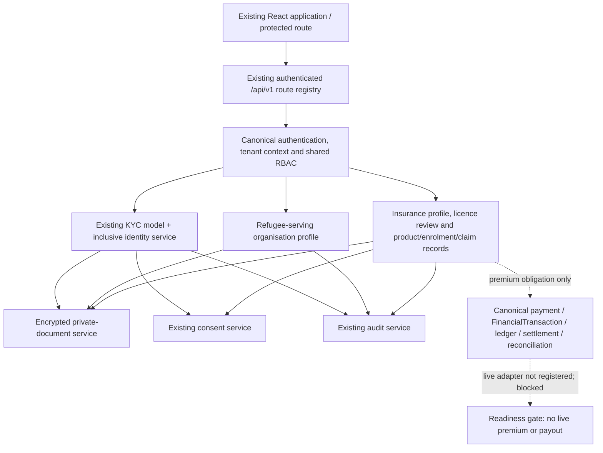

# TITech Capital LTD — Refugee-Inclusive Onboarding & Insurance Foundation

**Date:** 18 October 2026  
**Product:** TITech Community Capital  
**Repository baseline:** uploaded source ZIP `titech-community-capital-main(2).zip`  
**Engineering principle:** BUILD LESS. PROVE MORE. FINANCIAL CORRECTNESS BEFORE CONVENIENCE.

## 1. Status and scope

This change integrates refugee/asylum-seeker identity submission and review, refugee-serving organisation registration, insurance institution and licence review, insurer-owned product references, policy enrolments, premium obligations, claims administration references, encrypted private document storage and frontend entry points into the existing TITech application.

It reuses the platform's canonical authentication, server-resolved tenant context, shared RBAC, KYC model, consent records, audit service, API client, route registry and financial-control boundary. It does not add a second login system, tenant registry, KYC database, ledger or payment provider.

**This is an implementation foundation, not evidence of production approval.** All new workflow flags are disabled by default. Live insurance premium processing and payout initiation/settlement are intentionally unavailable because no verified canonical insurance financial adapter, live provider evidence, legal approval or production approval was present in the uploaded checkout. Automated checks in this report apply only to commands actually executed in the current environment; external integration and legal claims are not inferred from source code.

## 2. Integrated architecture



### Domain boundaries

- **Person/KYC:** An identity credential can use the existing national-ID route or an approved alternative credential type. The credential identifier itself is not persisted as plaintext by the new path; optional matching uses a dedicated HMAC key and remains unavailable without valid configuration.
- **Private evidence:** An opaque document reference maps to an encrypted file stored outside public web assets, with a per-document authenticated-encryption context, integrity hash and audit record. Supported upload types are PDF, JPEG and PNG, with a 10 MiB limit. A fail-closed ClamAV INSTREAM adapter was added on 22 October 2026. A live scanner, deployed health monitoring, safe test-signature evidence and an approved content-disarm decision remain production blockers.
- **Refugee-serving organisations:** The tenant-scoped profile stores the registration/compliance workflow. It does not grant broad access to participant profiles merely because an organisation is registered.
- **Insurance institution:** Legal identity, jurisdiction, competent authority, licence details, review provenance, agreement references and integration status are explicitly typed. Uploaded evidence is not equivalent to verified authorisation.
- **Insurance operations:** Product and coverage references, enrolment/coverage state, premium obligation, claim case and insurer decision references are separate records. TITech does not decide eligibility, issue policies, adjudicate claims or declare a payout settled solely from a user-entered reference.
- **Financial boundary:** The current insurance service creates a premium obligation record only. No direct balance changes or parallel ledger exist. Live settlement must be added by a separately reviewed adapter that invokes the existing canonical provider outcome → `FinancialTransaction` → ledger → receipt/outbox → reconciliation/audit pathway and passes the existing finance tests.

## 3. Server routes added

All routes are mounted under the repository's canonical authenticated, tenant-authorized `/api/v1` router. Exact paths are below; route-level permissions and capability flags are enforced on writes.

| Route | Purpose |
|---|---|
| `GET /api/v1/participant-onboarding/me` | Current participant KYC state, without raw document references |
| `GET /api/v1/participant-onboarding/me/capability` | State-based capability decision |
| `GET /api/v1/participant-onboarding/insurance-recipients/:recipientTenantId?language={en,sw,fr,ar}` | Resolve a registered insurer with current verified licence and return a versioned, language-specific data-sharing notice |
| `GET /api/v1/participant-onboarding/insurance-consent?recipientTenantId=...` | Read the authenticated participant's insurer-specific consent state in their source tenant |
| `POST /api/v1/participant-onboarding/insurance-consent` | Record explicit, self-service, versioned consent through the existing consent service |
| `POST /api/v1/participant-onboarding/insurance-consent/:consentId/withdraw` | Withdraw the authenticated participant's own insurer-specific consent |
| `POST /api/v1/participant-onboarding/credentials` | Submit an existing protected evidence reference for an approved credential type |
| `POST /api/v1/participant-onboarding/appeals` | Appeal a rejected participant KYC decision |
| `POST /api/v1/participant-onboarding/:userId/review` | Explicit reviewer decision; self-review and submitter-review blocked |
| `GET /api/v1/refugee-partners/me` | Read the current tenant's partner registration status |
| `POST /api/v1/refugee-partners` | Submit refugee-serving organisation profile/evidence |
| `POST /api/v1/refugee-partners/review` | Compliance review with separate-actor check |
| `POST /api/v1/documents/upload` | Upload raw binary to encrypted private evidence storage |
| `GET /api/v1/documents/:documentReference` | Tenant-scoped, purpose-authorized private document download |
| `GET /api/v1/insurance/institution` | Read insurance profile (evidence reference suppressed) |
| `POST /api/v1/insurance/institution` | Submit legal and regulatory profile with private licence evidence |
| `POST /api/v1/insurance/licence/review` | Record reviewer/source/reason for a licence decision |
| `GET /api/v1/insurance/readiness` | Current licence, storage, feature-flag and live-operation blockers |
| `GET /api/v1/insurance/products` / `POST /api/v1/insurance/products` | List/create product references |
| `POST /api/v1/insurance/products/:productId/activate` | Activate draft only with licence, evidence and maker-checker controls |
| `GET /api/v1/insurance/enrolments` / `POST /api/v1/insurance/enrolments` | List/submit enrolments with source-tenant consent and verified-participant references |
| `POST /api/v1/insurance/enrolments/:enrolmentId/decision` | Record insurer decision/policy/coverage references |
| `GET /api/v1/insurance/premiums` / `POST /api/v1/insurance/premiums` | List/create an obligation only; does not initiate a payment |
| `GET /api/v1/insurance/claims` / `POST /api/v1/insurance/claims` | List/submit claim cases; sensitive evidence is privately stored |
| `POST /api/v1/insurance/claims/:claimId/decision-reference` | Record insurer-sourced decision reference, not independent TITech adjudication |

Responses use the repository's existing API envelope/controller style. Confirm these contracts against live generated API/OpenAPI documentation before publishing external partner API documentation.

## 4. Capability flags and required configuration

New capability flags default to false. Keep them disabled unless the relevant tenant permissions, evidence storage, privacy/legal terms and operating controls have been validated.

| Variable | Purpose | Default |
|---|---|---|
| `TITECH_REFUGEE_ONBOARDING_ENABLED` | Participant credential submission, review and appeal | `false` |
| `TITECH_REFUGEE_PARTNER_ONBOARDING_ENABLED` | Refugee-serving organisation registration/review | `false` |
| `TITECH_INSURANCE_ONBOARDING_ENABLED` | Insurance institution/licence workflow | `false` |
| `TITECH_INSURANCE_OPERATIONS_ENABLED` | Product/enrolment/premium-obligation/claim workflow | `false` |
| `TITECH_DOCUMENT_ENCRYPTION_KEY` | Base64-encoded 32-byte AES-256 key for the private-document service | unset; secure operations fail closed |
| `TITECH_PRIVATE_DOCUMENT_STORAGE_PATH` | Private filesystem root outside public/web-served paths | unset; production startup/operations must configure it |
| `TITECH_KYC_IDENTIFIER_HMAC_KEY` | Dedicated base64-encoded key (at least 32 bytes) to produce a keyed credential-identifier fingerprint | unset; identifier matching fails closed |
| `TITECH_INSURANCE_LIVE_PREMIUM_PROCESSING_ENABLED` | Historical/configuration signal only; cannot enable payments without adapter | `false` |
| `TITECH_INSURANCE_LIVE_FINANCIAL_APPROVED` | Historical/configuration signal only; cannot enable payments without adapter | `false` |

Do not reuse JWT, refresh-token, Redis, webhook-signing or document-encryption keys for credential HMAC. Store secret values in the deployment's secret manager. Do not paste secrets into tickets, logs, source files or this report. The absence of the insurance payment adapter is an independent hard stop even if both insurance live-payment variables are set to `true`.

## 5. Database index setup

New collections require their declared indexes. A script is available:

```bash
npm --prefix backend run index:create:inclusive-insurance
# Or from repository root:
npm run db:indexes:inclusive-insurance
```

Run against an isolated test database first. Review index build impact, current duplicates and backup/restore readiness before applying to a production database. The command ensures indexes for secure document metadata, refugee-serving organisation profiles, insurance profiles, products, enrolments, premiums and claims. It does not migrate legacy KYC rows or automatically approve old records.

## 6. Core security controls

- Canonical JWT/session and tenant authorization remain authoritative; route handlers use the existing permission checker.
- Tenant IDs supplied as request data do not overwrite the server-resolved insurer scope. Source tenant existence and status are checked through the canonical `Tenant` model for insurance enrolment.
- KYC lifecycle transitions are enforced through the service layer. Refugee status, nationality, preferred language or absence of NIN is not an automatic rejection/risk signal.
- Manual verification requires reviewer attribution, transition validation, valid evidence and separation from both the participant and submission actor.
- Enrolment requires an active `INSURANCE_ENROLMENT` consent record in the participant source tenant, scoped to the receiving insurer and expected data categories. A free-form reference alone is not proof of consent.
- Licence and product activation require separate reviewed evidence; creators cannot approve their own licence/product submission.
- Private uploads verify MIME type and file signature, cap bytes, encrypt with AES-256-GCM, bind encryption to tenant/reference/purpose, suppress raw evidence references in ordinary profile responses and audit document operations.
- Premium monetary amounts are positive safe integer minor units with validated three-letter currency codes. Premium status cannot become `SETTLED` without provider, financial transaction, ledger, settlement and reconciliation references.
- Claims are tracked but not automatically adjudicated; `PAID` requires payout/settlement/reconciliation evidence. No live payout processor is included.
- Client controls and route visibility are not authorization. Backend role, tenant, capability and lifecycle checks remain authoritative.

## 7. Known gaps that remain release blockers

1. **No production provider verification:** no regulator/government identity API or insurer-specific API was configured or verified in this archive. Manual reviews require approved operational policy and a trusted official source.
2. **No live insurance financial adapter:** premium payment initiation, provider callback processing, ledger postings, receipts/outbox and payout settlement are not implemented by these new insurance modules. They must be connected through TITech's canonical existing financial architecture and tested against duplication, reversal and reconciliation scenarios.
3. **No external legal/privacy sign-off:** data-controller/processor roles, lawful basis, retention, transfer controls, licensing scope and regulated-activity boundary require qualified local review and partner agreements.
4. **Private document malware scanning:** a fail-closed ClamAV INSTREAM adapter now runs before persistence. The real scanner endpoint, health/alerting, safe test-signature proof and any approved content-disarm workflow remain unverified; do not enable live sensitive-document uploads until these controls are validated.
5. **Offline assisted registration:** the existing offline engine was not replaced; a complete field-worker offline UI/sync flow, replay/conflict tests and server revalidation have not been demonstrated by this patch.
6. **Translation QA:** English is source language. Swahili, French and Arabic resources are still drafts pending review; the new screen contains some domain terms/messages that require fuller localization. RTL stylesheet and direction support reuse existing infrastructure but need browser-based visual/assistive technology testing.
7. **Build/runtime test environment:** this ZIP has no `.git` directory or installed dependencies. The current environment runtime detected Node `v22.16.0` / npm `10.9.2`, while project package metadata requires Node `>=24.15.0` and npm `>=11`; dependency-backed build and live service tests must be repeated on the declared runtime.
8. **Partner pilot and external approvals:** no pilot partner confirmation, security assessment, data-protection review, regulator approval, backup/restore rehearsal or production approval is implied.

## 8. Readiness classification

| Capability | Local implementation state | Permitted scope now |
|---|---|---|
| Alternative identity model/service | Implemented; pure policy tests added; database-backed integration requires test DB and dependency install | Disabled unless refugee onboarding flag, policy and secure storage are approved |
| National ID compatibility | Legacy KYC paths/types retained in schema; full regression needs existing test suite | Existing production behavior unchanged only subject to regression verification |
| Manual KYC review | Service-level review/transition/self-review controls implemented | No live use until permissions/reviewer process/privacy approved |
| Private evidence | Encrypted file and metadata service implemented; key/storage required | No sensitive production evidence until key, private path and scanning controls verified |
| Refugee-serving organisation | Tenant-scoped model/service/review flow implemented | Disabled by default; needs partner vetting and privacy agreements |
| Insurance institution/licence | Profile and review state machine implemented | No restricted operations without verified licence and partner/legal approval |
| Products/enrolments/premiums/claims | Minimal references and workflows implemented | Test/reference management only; no underwriting/adjudication or real money processing |
| Live premium/payout | Not implemented; explicit hard-stop responses | Prohibited/blocked |
| Localization/Arabic RTL | New resources and UI route added; draft translations | English is source; human translation and browser accessibility review required |
| Production approval | Not demonstrated | **NO** |

## 9. Current official review points (Uganda)

Use qualified legal/compliance advice to map the real product activities before a live pilot. Official source starting points include:

- Insurance Regulatory Authority of Uganda: <https://ira.go.ug/> and <https://ira.go.ug/regulations/>
- Personal Data Protection Office: <https://pdpo.go.ug/knowledge-center> and <https://pdpo.go.ug/information-center/resources>
- Uganda Data Protection and Privacy Act, 2019 (consolidated text on ULII): <https://ulii.org/en/akn/ug/act/2019/9/eng%402023-12-31>

This list is not a legal opinion or an exhaustive regulatory analysis. Confirm current licensing, data-protection, transfer, AML/CFT, identity and electronic-record obligations directly with qualified advisers and competent authorities. Software features do not confer authorization to underwrite, distribute insurance, hold customer money or adjudicate regulated claims.


## Malware scanning boundary (22 October 2026)

Private document uploads now call a fail-closed ClamAV `INSTREAM` adapter before encryption or database metadata creation. This code is tested against a local protocol mock; it does not establish that a real scanner is deployed, healthy, kept current or validated using the scanner vendor's safe test-signature procedure. Configure the private scanner host/port and prove scanner health before enabling identity or insurance upload capabilities.
